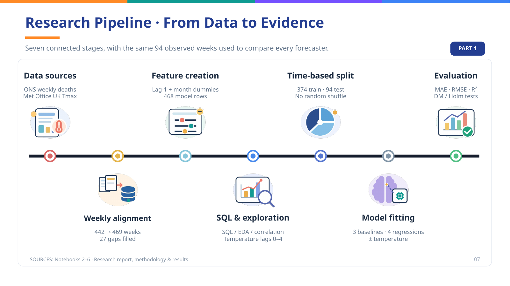
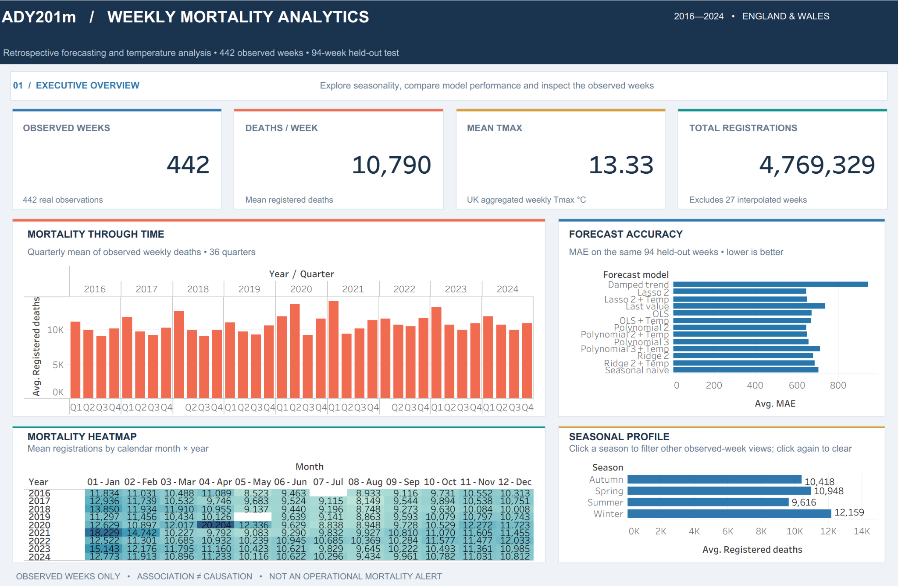

# Weekly Mortality Forecasting in England & Wales

**Retrospective analysis of weekly all-cause mortality, temperature, and forecast accuracy (2016–2024).**

This ADY201m research project connects the Office for National Statistics (ONS) weekly death-registration series for England and Wales with Met Office weekly maximum-temperature summaries. It examines the seasonal association, benchmarks several regression approaches against simple time-series references, and asks **whether temperature provides consistent predictive information beyond recent mortality and calendar effects**.

> **Scope:** This is a reproducible *course-level forecasting audit*, not a causal estimate of temperature-attributable deaths or an operational public-health warning model.



## Research questions

| Research question | Main evidence |
|---|---|
| **RQ1.** How do weekly mortality and temperature vary by season and at temperature lags of 0–4 weeks? | SQL, Python EDA, monthly profiles, Pearson/Spearman correlations |
| **RQ2.** Do common regression models improve on simple time-series references over a chronological holdout? | OLS, polynomial, ridge, lasso vs. last-value, seasonal-naive and damped-trend baselines |
| **RQ3.** Does adding temperature improve forecasts reliably across cold, mild and warm weeks? | With/without-Tmax comparisons, ablations, phase-specific MAE, paired statistical tests |

## Key results

| Item | Finding |
|---|---|
| Observed series | **442 weeks** (2016–2024) |
| Prepared weekly grid | **469 weeks**, including **27 interpolated calendar gaps** |
| Regression rows | **468** after creating a one-week mortality lag |
| Train/test | **374 / 94** chronological rows; test outcomes are observed, not interpolated |
| Pearson correlation (same week) | **r ≈ −0.474** between weekly mortality and mean weekly Tmax |
| Strongest Pearson lag in the 0–4-week scan | **Lag 2**, **r ≈ −0.492**; this is *not* evidence of a causal two-week effect |
| Lowest held-out regression MAE | **≈643.9 deaths/week** (degree-two polynomial and lasso) |
| Last-value baseline MAE | **≈738.8 deaths/week** |
| Temperature value | Mixed: some temperature-phase improvements but no consistent pooled gain |
| Statistical caveat | Holm-adjusted paired tests **do not confirm forecast superiority** |

The models with an observed temperature measurement for the target week must be treated as **retrospective** comparisons. These results are not a real-time forecast using a weather forecast available beforehand. The reported fixed-alpha benchmark also has model-selection limitations; see [Methodology notes](docs/RESEARCH_NOTES.md).

## Interactive dashboard

The packaged Tableau workbook is at [`dashboard/Weekly_Mortality_Tableau.twbx`](dashboard/Weekly_Mortality_Tableau.twbx). The workbook contains views for executive findings, business understanding, data preparation, SQL, Python EDA, visualization, regression and AI audit context.



> Tableau Desktop is required to open the `.twbx` workbook. Use the report and notebooks as the authoritative record for scientific results.

## Repository contents

```text
.
├── 1. Business Understanding and Analysis.ipynb
├── 2. Data Collection, Understanding, and Preparation.ipynb
├── 3. Data Analysis with SQL.ipynb
├── 4. Data Analysis with Python.ipynb
├── 5.Data_Visualization.ipynb
├── 6.Regression_Analysis.ipynb
├── uk_weather_health_weekly_2016_2024_TOTAL_FINAL.csv
├── uk_weather_health_weekly_CLEANED.csv
├── uk_weather_health_data_dictionary.csv
├── metoffice_general_regions_tmax_2024.csv
├── united_kingdom_outline.geojson
├── requirements.txt
├── scripts/verify_data.py
├── dashboard/Weekly_Mortality_Tableau.twbx
├── report/Weekly_Mortality_Forecasting_Report.pdf
├── slides/
│   ├── Weekly_Mortality_Full_Presentation.pptx
│   └── Weekly_Mortality_10Min_Presentation.pptx
└── docs/
    ├── README_RUN_ALL.md
    ├── RUN_ALL_VALIDATION.txt
    ├── SOURCE_CROSS_REFERENCE.md
    ├── CHANGELOG.md
    ├── RESEARCH_NOTES.md
    ├── GITHUB_UPLOAD_GUIDE.md
    ├── TROUBLESHOOTING.md
    └── assets/
```

**Why are the notebook and CSV files at the repository root?** The validated notebook cells use relative filenames such as `uk_weather_health_weekly_CLEANED.csv`. Keeping these files together preserves the successful `Restart & Run All` execution order without changing scientific code or the slide-to-cell cross-references.

## Quick start

Use **Python 3.11+** (the bundled execution validation was completed with Python 3.13.5).

```bash
# Clone your published repository once its URL is available:
# git clone https://github.com/YOUR_USERNAME/weekly-mortality-forecasting.git
# cd weekly-mortality-forecasting

python -m venv .venv

# Windows PowerShell:
# .venv\Scripts\Activate.ps1
# macOS / Linux:
source .venv/bin/activate

python -m pip install --upgrade pip
python -m pip install -r requirements.txt
python scripts/verify_data.py
jupyter lab
```

Then execute notebooks **1 → 6** in order, using **Kernel → Restart Kernel and Run All Cells** for each. Notebook 2 re-exports `uk_weather_health_weekly_CLEANED.csv`; its result was previously checked against the bundled prepared CSV. Notebook 5 uses Shapely for the regional-temperature geometry. Install dependencies into the *same Python kernel* used by Jupyter if an import fails.

For complete instructions see [`docs/README_RUN_ALL.md`](docs/README_RUN_ALL.md) and [`docs/TROUBLESHOOTING.md`](docs/TROUBLESHOOTING.md). For previous execution checks see [`docs/RUN_ALL_VALIDATION.txt`](docs/RUN_ALL_VALIDATION.txt). To map slide numbers to notebook sections and cells see [`docs/SOURCE_CROSS_REFERENCE.md`](docs/SOURCE_CROSS_REFERENCE.md).

## Dataset provenance and important definitions

- **ONS:** [Deaths registered weekly in England and Wales, provisional](https://www.ons.gov.uk/peoplepopulationandcommunity/birthsdeathsandmarriages/deaths/datasets/weeklyprovisionalfiguresondeathsregisteredinenglandandwales).
- **Met Office:** [HadUK-Grid climate observations](https://www.metoffice.gov.uk/research/climate/maps-and-data/data/haduk-grid/).
- `uk_weather_health_weekly_2016_2024_TOTAL_FINAL.csv` is a **project-level merged observed dataset** (442 weeks), *not the two unmodified agency source downloads*.
- `uk_weather_health_weekly_CLEANED.csv` is the **prepared regular weekly grid** (469 rows); the 27 interpolated rows are synthetic estimates and must **not** be added to actual observed mortality totals.
- `tasmax_mean_weekly_degC` means the **weekly mean of daily maximum temperature**, not mean ambient temperature. Mortality relates to England and Wales whereas the principal weather exposure is aggregated at UK scale.
- The separate 2024 regional temperatures support **temperature-only geographic context**, not region-specific mortality estimates.

The source datasets and any derived data are subject to their original attribution/licensing terms; include the source citations when reusing or publishing the material. A project-wide software license has **not** been assigned in this package.

## Conclusions and limitations

The research shows an opposing seasonal pattern in mortality and temperature, plus some retrospective MAE improvements relative to simple baselines. However, the confidence supported by the holdout is limited: the temperature contribution is inconsistent, paired tests do not establish a statistically confirmed advantage after multiple-testing adjustment, and important confounders (such as influenza, air pollution, age and population dynamics) are unavailable. Registration dates may not be the dates of death.

A stronger future study would include daily regional data, epidemiological controls, prospective weather inputs and walk-forward validation with tuning restricted to training data.

## Academic materials and AI transparency

- [Full paper (PDF)](report/Weekly_Mortality_Forecasting_Report.pdf)
- [Full presentation (PowerPoint)](slides/Weekly_Mortality_Full_Presentation.pptx)
- [10-minute presentation with backup slides](slides/Weekly_Mortality_10Min_Presentation.pptx)
- [Research notes and caveats](docs/RESEARCH_NOTES.md)

An individual **AI Audit Log** with prompts, error cases and human verification belongs to the course submission materials. It is intentionally **not included in this public-ready code package**, because the full log contains personal/student information. The audit can be shared separately with an instructor through the course's approved channel.

**Submission note:** The paper and presentations may themselves contain author names/contact information. Review those files and the notebook outputs before changing a GitHub repository to Public.
